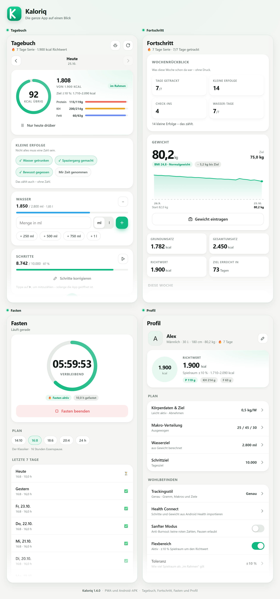
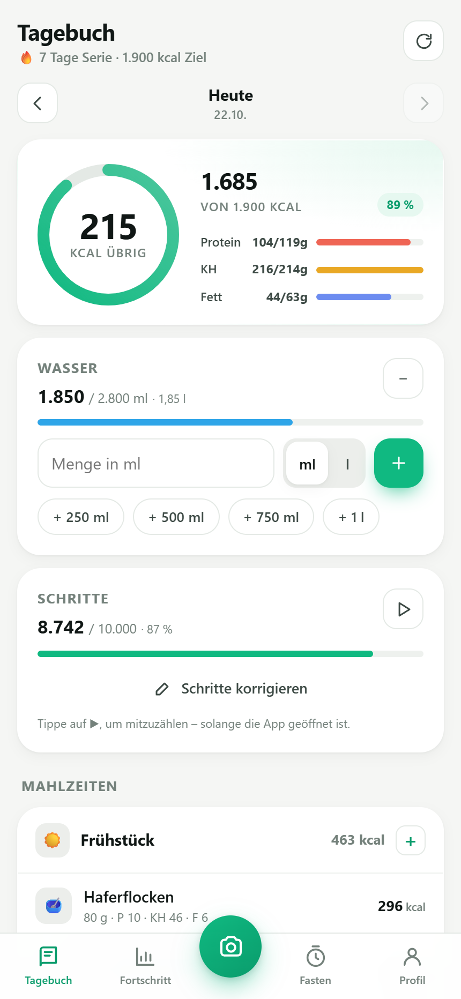
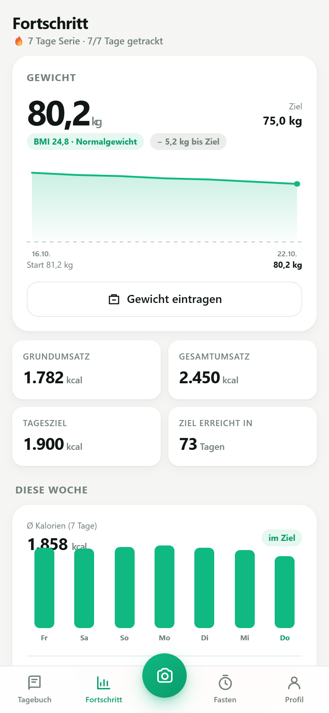
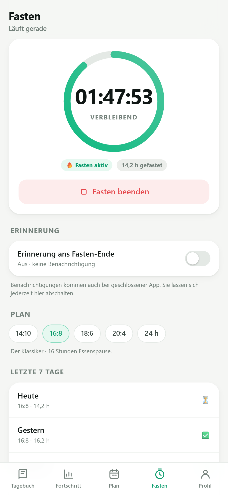
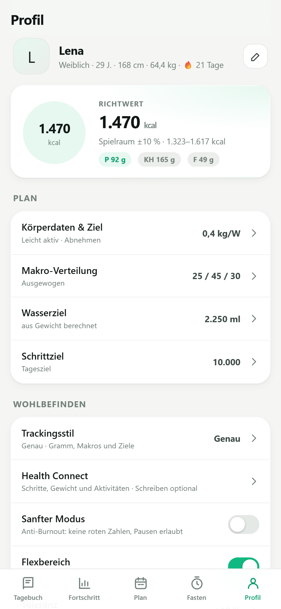

# Kaloriq

**Language:** [Deutsch](README.md) · [English](README.en.md)

Calorie, macro and fasting tracker with AI photo recognition – as an installable web app (PWA), optimized for **Android** (runs the same way on iPhone).

An independent implementation of the features of well-known calorie trackers. No third-party brands or assets, no cloud: **all data stays on the device.** The barcode scanner uses ZXing (Apache-2.0) – natively in the Android APK and as a locally bundled JavaScript library in Safari/Firefox – see [third-party notices](THIRD_PARTY_NOTICES.md).

**Current version: 1.2.12** · [Install on iPhone](https://arti1984-collab.github.io/kaloriq/) · [Download Android APK](https://github.com/arti1984-collab/kaloriq/releases/tag/v1.2.12) · [Changelog](CHANGELOG.md)

Follow Kaloriq on [TikTok: @kaloriq](https://www.tiktok.com/@kaloriq).



> Screenshots with demo data in the light theme. The app automatically follows the system theme (light/dark).

---

## Screenshots

| Diary | Progress |
|---|---|
| [](docs/screenshots/tagebuch.png) | [](docs/screenshots/fortschritt.png) |

| Fasting | Profile |
|---|---|
| [](docs/screenshots/fasten.png) | [](docs/screenshots/profil.png) |

All images are in [`docs/screenshots/`](docs/screenshots/) – as individual views and
as a 2×2 montage (`uebersicht.png`).

---

## Features

| Area | Scope |
|---|---|
| **Onboarding** | Sex, age, height, weight, target weight, activity level, goal (lose/maintain/gain), pace → calorie and macro plan (Mifflin-St Jeor + PAL) |
| **Diary** | Breakfast / lunch / dinner / snacks, daily ring, macro bars, edit & delete entries, browse days, streak |
| **Food search** | ~130 local foods (offline, reference values per 100 g) + Open Food Facts on request |
| **Barcode** | Camera scan in the APK (native ZXing scanner), in Chrome (`BarcodeDetector`) and in Safari/Firefox (ZXing JS), or type the number → Open Food Facts |
| **AI tracking** | Photo **or** text → Gemini estimates ingredients, grams, calories & macros. Every item editable, individual items can be deselected |
| **Custom foods** | With nutrition values per 100 g + optional serving, stored permanently |
| **Recipes** | Your own recipes with ingredients and nutrition per 100 g, servings, tags and preparation; add a serving to the diary, JSON import/export |
| **Water** | Free input in **ml or liters**, quick values (+250 ml … +1 l), daily progress, goal based on weight |
| **Steps** | Step counter via the device sensor (APK: also counts while the app is closed), daily goal, manual correction, stored per day |
| **Weight** | Input, history chart, target weight, BMI, forecast to goal |
| **Week** | Average calories, bar chart per day, macro average, daily history |
| **Fasting** | 14:10 / 16:8 / 18:6 / 20:4 / 24 h, live timer, history of the last 7 days |
| **Data** | JSON export/import, automatic backups, IndexedDB second copy, reset |
| **Wellbeing** | Gentle mode with pause, **minimal mode** (no ring, target or macros) and **flex range** ±5–15 % – less perfection pressure, no red numbers |
| **Grace days** | 0–3 blank days per month don’t break the streak – automatic, local, no points |
| **Pause mode** | “Just today off” or 3/7/14 days/open – streak frozen, no calorie pressure |
| **Hunger & satiety** | Optional 1–10 check-in per meal, before and after eating – no obligation, no judgement |
| **Small wins** | Water, walk, mindful eating, time for myself – non-number wins to tap, without points |
| **Hand portions** | Small/medium/large instead of grams – with a rough gram guide, no scale |
| **Quick log** | Light/regular/hearty per meal – rough estimate without grams |
| **Language** | German / English – switch under **Profile → Language**, all screens translated instantly |
| **APK** | Standalone Android app, fully offline (`npm run apk`) – see [ANDROID.md](ANDROID.md) |

### Diary & AI tracking

- Daily ring with **remaining calories**, percentage and macro bars
  (protein / carbs / fat) – all based on your personal plan.
- Four meals (breakfast, lunch, dinner, snacks), **edit, move and delete**
  entries, browse days forwards and backwards, daily note.
- **Streak**: counts consecutive days with at least one entry.
- Add foods via the local database (~130 foods, offline), Open Food Facts
  search, **barcode** (camera scan in the APK, Chrome, Safari and Firefox;
  the number can be typed anywhere), custom foods and favorites.
- **AI photo or text**: Gemini estimates ingredients, grams, calories and
  macros; every item can be edited and deselected individually before saving.
  Without an API key, a clearly marked demo mode runs.
- **Hand portions:** In the quantity view, switch between grams and hand
  portions. Small/medium/large estimate the amount from the stored portion or
  100 g – no scale, with a visible gram guide.
- **Quick log:** Per meal, a rough estimate as light, regular or hearty
  (20/30/40 % of the daily target) – optionally with a name. The entry is
  marked as a “rough estimate” and can be edited later.

### Recipes

- Create, edit and delete your own recipes. Pick ingredients from the local
  database or enter nutrition per 100 g manually; add servings, tags and
  preparation steps.
- Calories and macros are calculated per serving and per 100 g. A serving can
  be added to the diary as **one** entry.
- Recipes stay local and are included in the automatic backups. Export and
  import as `kaloriq-recipes` JSON for backup or sharing; there is no community
  database or cloud sync.

### Water

- Free input in **ml or liters** (e.g. `250`, `0.5`, `1 l`) plus quick values
  (+250 ml, +500 ml, +750 ml, +1 l) and a minus button.
- Progress bar and daily goal based on weight (35 ml per kg, 1.5–4 l).
- Stored per day and shown in the weekly history.

### Steps

- **Android APK:** native step counter via `TYPE_STEP_COUNTER`. The sensor
  keeps counting while the app is closed; the next time you open Kaloriq, it
  adds the difference. The display refreshes at least every 0.5 seconds and
  shows the current reading immediately when returning from the background.
  For the live display, `TYPE_STEP_DETECTOR` is used as well (one event per
  step); storage still uses the cumulative counter so nothing is counted twice.
- Day changes, device restarts and long pauses (> 20 h) are handled;
  **stale sensor values** (older than 5 minutes) are ignored to avoid incorrect
  step counts.
- Daily goal, manual correction and storage per day. In the PWA, the motion
  sensor only counts while the app is open; web apps cannot access Apple Health.
  Steps can be entered manually at any time.

### Progress & weight

- Weight input, history chart, target weight, **BMI** and forecast to goal
  based on the selected pace.
- Basal metabolic rate (Mifflin-St Jeor), total daily energy expenditure (PAL)
  and daily goal at a glance.
- Weekly evaluation: average calories, bars per day, macro average and daily
  history with entries and water.

### Fasting

- Plans **14:10, 16:8, 18:6, 20:4 and 24 h**.
- Live timer with remaining time, progress ring, start/stop and history of the
  last seven days.
- A running fast survives closing the app and continues counting when you
  reopen it.

### Wellbeing (anti-burnout)

- **Gentle mode:** weekly range instead of daily pressure, no red numbers and a
  pause that hides the calorie target in the diary – without deleting data.
- **Minimal mode:** hides the daily ring, calorie target, macros and weekly
  balance. Meals, water, steps, weight and history stay visible.
- **Flex range:** ±5 %, ±10 % or ±15 % around the guide counts as “within
  range”. Inside that range everything stays neutral, even when a day is
  slightly above target. Can be switched off; default is ±10 %.
- **Grace days:** 0–3 blank days per calendar month don’t break the streak.
  They are used automatically, but only when they bridge a gap between two
  logged days. Default is 2; the setting shows used and remaining grace days
  for the current month.
- **Pause mode:** “Just today off”, 3 days, 1 week, 2 weeks or an open end.
  Calorie target, ring, macros and weekly balance are hidden during the pause,
  the streak is frozen. Logging stays optional; the pause can be extended,
  shortened or ended at any time.
- **Hunger & satiety:** Optional check-in per meal with two 1–10 scales
  (hunger before eating, satiety afterwards). One rating is enough; tap a
  selected number again to remove it. The feature can be shown or hidden under
  **Profile → Wellbeing** and is stored locally only.
- **Small wins:** Four non-number wins per day to tap – drank water, went for a
  walk, ate mindfully, took time for myself. No points, no streaks, no
  judgement; a selected win just gets a calm check mark. Can be hidden under
  **Profile → Wellbeing**.

### Profile, language & data

- Change body data, goal and pace → calorie and macro plan recalculated
  instantly; macro split, water and step goals configurable.
- **German / English** switchable instantly (including date and number
  format); entries and profile remain unchanged.
- **JSON export/import**, automatic backups (every 12 hours, up to three
  snapshots) and a reset that automatically creates a backup first.
- Gemini key stored locally or used via the server proxy; load the model list
  directly from the Google API.

---

## Getting started

```bash
npm start
```

The server needs **no** dependencies (pure Node ≥ 18). On startup it shows two addresses:

```
Local:   http://localhost:4173
Phone:   http://192.168.x.x:4173   (same Wi-Fi)
```

## Installing on an Android phone

**Important:** Chrome only installs a web app over **https://** (or `localhost`). Over `http://192.168.x.x:4173`, the "Install app" menu item is missing – that's a browser rule, not an app bug.

### Option 1 – with an HTTPS tunnel (recommended, full app incl. offline)

```bash
npm start          # terminal 1: server
npm run tunnel     # terminal 2: create HTTPS address
```

`npm run tunnel` starts a Cloudflare Quick Tunnel and prints an address like
`https://humanities-grande-wiring-instruments.trycloudflare.com`.

1. Open this **https://** address in Chrome on your phone.
2. Menu **⋮ → "Install app"**.
3. Done: own icon, fullscreen, works offline.

On first start, the script does not download `cloudflared` itself – if it is missing, it shows a one-liner to install it.

> The address changes every time the tunnel restarts. After a PC restart, run `npm run tunnel` again and reinstall the app once. For a **fixed address**, see [DEPLOY.md](DEPLOY.md) – the address (and therefore your storage) stays the same permanently.

### Option 2 – fixed address, updates without data loss (recommended)

```bash
npm run build:static     # creates dist\ with all files for hosting
```

Upload the contents of `dist\` once to **Cloudflare Pages** (Upload assets) or
**Netlify Drop** → fixed `https://…` address. Updates later:
`npm run build:static` and upload again – **same address, same data**.

Details: [DEPLOY.md](DEPLOY.md)

### Option 3 – own APK (fully offline)

```powershell
npm run apk
```

Creates `Kaloriq-<version>.apk` in the project folder: a standalone Android app
with all files on board, no server and no browser. Copy it to your phone,
tap it, allow "Unknown sources", install.

Updates later: `npm run bump` + `npm run apk`, install the new APK over the old
one – **data is preserved** (same package name + signing key).
Details: [ANDROID.md](ANDROID.md)

### Option 4 – LAN only, no installation

Open `http://192.168.x.x:4173` on your phone. The app works fully, but:
- no install menu item,
- no offline cache,
- Chrome may show "Not secure".

As a workaround, Chrome allows **⋮ → "Add to Home screen"** – however, this is only a shortcut, not an installed app.

After that, Kaloriq starts fullscreen with its own icon, without a browser bar.

> **Why HTTPS at all?** Service workers (offline cache) and the install prompt only run in a "secure context" – i.e. `localhost` or `https://`. Static hosting also works: run `npm run build:static` and upload the contents of `dist\` to Netlify Drop or Cloudflare Pages, for example (no build, no server required).

## Installing on an iPhone (PWA)

If the app should be free for everyone, the PWA is the direct route: no App Store, no Apple Developer account, no $99 per year. The app is available directly via **GitHub Pages**:

**https://arti1984-collab.github.io/kaloriq/**

> Detailed step-by-step guide in German and English: [INSTALL-IPHONE.md](INSTALL-IPHONE.md)

1. Open this address in **Safari**.
2. Tap **Share** → **Add to Home Screen** → **Add**.
3. Kaloriq appears with its own icon and opens fullscreen; data stays on the device.

> **Important:** Always use the same fixed address. A new address means a new, empty storage on iPhone. So don't use changing Quick Tunnel addresses for installation.

> **Why no native iOS app from GitHub?** Apple signs iOS apps. An IPA from a GitHub release cannot simply be tapped and installed – that would require a Mac, an Apple Developer account and sideloading or TestFlight. The PWA is the only route that works without an Apple account and without the App Store.

**Barcode scanning:** Works directly in Safari, too. On the first scan, iOS asks for camera permission.

**What is different on iPhone:**

- **Steps:** The PWA only counts while the app is open because Safari has no access to Apple Health and pauses web apps in the background. Steps can be entered manually; the Android APK also counts in the background.
- **Storage:** Kaloriq requests persistent storage and keeps an automatic second copy in IndexedDB. A JSON export via **Profile → Export data** remains available as an optional extra backup.
- **App Store:** The app would also be free for users there, but you pay **$99 per year** plus a Mac with Xcode. The PWA costs neither you nor users anything.

## Setting up AI (Google Gemini)

1. Create a key: <https://aistudio.google.com/apikey> (the free tier is enough for testing).
2. In the app: **Profile → Connect Gemini** → paste the key → save.
3. Model: the default is `gemini-3.8-flash`. Next to the model field, **"Load"** asks Google which models your key can actually use and fills in the best available one.

> **Important:** Model names become outdated. Older models such as `gemini-2.5-flash` are blocked for **new** API keys ("model not found"). In that case the app automatically switches to an enabled model; alternatively, tap "Load" in the settings and choose a model from the list.

Without a key, AI estimation runs in **demo mode**: it looks up the named foods in the local database and clearly marks the result as a demo. This is only intended for trying out the interface.

**Keep the key secret?** If the server is started with the key, it stays on the computer and the app uses it through a proxy:

```powershell
$env:GEMINI_API_KEY="AIza…"; npm start
```

The app detects this automatically (Profile → "Server proxy: available"). On a phone without a running server, the key is stored locally – that's fine for personal use, but any device with access can read it.

---

## Language (German / English)

**Profile → Language** → German or English. The choice applies immediately to
the whole app (including date and number format: `2.240` ↔ `2,240`) and is
saved in the settings. **Entries, weights, profile and API key remain
unchanged** – the language is only a display layer.

Technically: `public/js/i18n.js` contains the dictionary (German source texts →
English texts), patterns for dynamic texts (numbers, dates) and
`applyI18n()`, which translates visible texts after each render. If an entry is
missing, the German text remains – so the app always works.

---

## Development workflow

Kaloriq is deliberately built **without a bundler and without npm dependencies**:
pure ES modules that the browser loads directly. This makes every change
immediately visible, and the APK is built from the same source as the PWA.

### Rules for every change

1. **Bump the version:** After every change to `public/` (code, styles, texts,
   manifest, icons), the version increases – see [Versioning](#versioning).
2. **Never delete data:** `localStorage` (`kaloriq.state.v1`) and the IndexedDB
   second copy (`kaloriq.storage.v1`) are preserved. `migrate()` only adds
   missing fields; a backup is created automatically before import and reset.
3. **Test:** Desktop browsers (Chrome/Edge/Safari) and Android – the PWA in the
   browser **and** the installed APK; test the barcode scanner additionally in
   Safari and on iPhone. Add new JS files to the `SHELL` list in
   `public/sw.js`, otherwise they are missing offline.
4. **Build the APK:** `npm run apk` creates a signed
   `Kaloriq-<version>.apk`. The signing key is stored only locally under
   `android-app/keystore/` and is **not** in the repository.
5. **Publish:** Commit and push to `main`; attach the APK to a GitHub release.

### Versions

| Version | Focus |
|---|---|
| **1.2.13** | Hand portions and quick log (rough log) |
| **1.2.12** | Small non-number wins in the diary (no points or streaks) |
| **1.2.11** | Hunger/satiety check per meal (optional, 1–10) |
| **1.2.10** | Pause mode: “just today off” or several days with a frozen streak |
| **1.2.9** | Grace days: 0–3 blank days per month don’t break the streak |
| **1.2.8** | Live steps via `TYPE_STEP_DETECTOR`, counting stays cumulative |
| **1.2.7** | Step counter responds faster (500 ms, immediate value after resume) |
| **1.2.6** | Minimal mode and flex range against perfection pressure |
| **1.2.5** | TikTok link in the profile and on the GitHub project page |
| **1.2.4** | Local recipes with ingredients, nutrition, servings, diary logging and JSON exchange |
| **1.2.3** | Persistent storage and IndexedDB second copy against iOS storage cleanup |
| **1.2.2** | Barcode scanner for Safari/Firefox (ZXing JS), camera cleanup, iPhone docs |
| **1.2.1** | Native barcode scanner in the APK (ZXing), English scan label |
| **1.1.9** | Protection against stale sensor values; release APK |
| **1.1.8** | Import resets the native step counter reading |
| **1.1.7** | Native Android step counter (also works when the app is closed) |
| **1.1.6** | Fixed quick access, free water input in ml/l, first step counter |
| **≤ 1.1.5** | Base version (not documented individually) |

The detailed history of all changes, fixes and technical notes is in
**[CHANGELOG.md](CHANGELOG.md)**.

---

## Versioning

The version is bumped with every change – one command, four places:

```powershell
npm run bump          # 1.1.1 → 1.1.2
npm run bump 1.2.0    # fixed version
```

Updates `package.json`, `public/js/version.js` (display under Profile),
`public/sw.js` (cache name) and rebuilds `dist\`. If the Android project is
present, the APK's `versionName`/`versionCode` are updated as well.

---

## Updates & data backup

**An update does not delete data.** App data lives in browser storage:
`localStorage` (`kaloriq.state.v1`) as the fast primary copy and IndexedDB
(`kaloriq.storage.v1`) as an automatic second copy. On startup, the app restores
the second copy if iOS has cleared `localStorage` under storage pressure. It
also requests persistent storage (`navigator.storage.persist()`) so the browser
clears the data less often. New JS files never overwrite these copies. On load,
`migrate()` in `public/js/store.js` only adds missing fields – existing values,
days, weights and the API key remain unchanged.

Additionally:

- **Automatic backups:** every 12 hours, up to 3 snapshots – mirrored in
  IndexedDB. Restore under **Profile → Backups**.
- Before **importing data** and **resetting everything**, the current state is
  backed up automatically – both are recoverable.
- **Manual backup:** Profile → Export data (JSON).

> The only case where data "goes missing" is a **new web address**
> (e.g. a new Quick Tunnel). The browser separates storage per address.
> So: move to a fixed address once (see [DEPLOY.md](DEPLOY.md)), and this
> will never happen again.

---

## Calculations

- **Basal metabolic rate:** Mifflin-St Jeor
  `10 × kg + 6.25 × cm − 5 × age + (m: +5 | f: −161)`
- **Total daily energy expenditure:** BMR × PAL (1.2 / 1.375 / 1.55 / 1.725 / 1.9)
- **Calorie goal:** TDEE ± pace × 1,100 kcal/day (1 kg body fat ≈ 7,700 kcal), never below BMR or 1,200 (f) / 1,500 (m) kcal
- **Macros:** presets 25/45/30, 35/35/30, 30/20/50 (protein/carbs/fat as % of calories)
- **Water:** 35 ml per kg, rounded, 1.5–4 l
- **BMI:** kg / m², WHO categories

All values are guidelines – **not a medical device**, no diagnosis, no therapy.

---

## Project structure

```
server.mjs              Zero-dependency server + optional Gemini proxy
CHANGELOG.md            Version history and development rules
AGENTS.md               Working rules for changes to the app
THIRD_PARTY_NOTICES.md  Third-party notices (ZXing, Apache-2.0)
LICENSES/               Apache-2.0 license text
ANDROID.md              APK build, signing, native scanner and step counter
DEPLOY.md               Fixed web address (GitHub Pages / Cloudflare / Netlify)
INSTALL-IPHONE.md       iPhone installation (Deutsch / English)
README.en.md            This page in English
docs/screenshots/       Screenshots for README and GitHub
public/
  index.html            App shell
  manifest.webmanifest  PWA manifest (icons, shortcuts)
  sw.js                 Service worker (offline, network-first)
  css/app.css           Design system (light/dark, safe areas)
  vendor/
    zxing.min.js        ZXing JS for the barcode scanner in Safari/Firefox
    zxing.LICENSE.txt   Apache-2.0 license text for the ZXing JS library
  js/
    app.js              Bootstrap, router, tabs, install prompt
    store.js            State + localStorage/IndexedDB, days, statistics
    calc.js             BMR/TDEE/goals, macros, fasting plans
    foods.js            Local DB (~130 foods) + Open Food Facts
    recipes.js          Recipe model, nutrition math, JSON import/export
    i18n.js             Language switching (dictionary, patterns, DOM translation)
    ai.js               Gemini calls, image resizing, demo mode
    ui.js               Sheets (with back button), toasts, charts, icons
    pause.js            Pause mode (today, several days, open end)
    checkin.js          Hunger/satiety check per meal
    wins.js             Small non-number wins in the diary
    views/              onboarding · diary · add (search/barcode/AI) · recipes · progress · fasting · profile
android-app/            Capacitor project for the APK (see ANDROID.md)
scripts/build-apk.mjs   Build the APK (npm run apk)
scripts/make-icons.mjs  Generate the PNG icons (npm run icons)
scripts/tunnel.mjs      HTTPS tunnel for installation (npm run tunnel)
```

### Technical decisions

- **No build step, no frameworks** – ES modules that run directly in the browser. Changes are immediately visible, and the app remains maintainable for years.
- **No external runtime dependencies** – no npm packages or CDNs. The only third-party library (ZXing JS for the Safari scanner) is bundled locally under `public/vendor/` and keeps working even if libraries or CDNs disappear. The APK additionally bundles ZXing natively.
- **Data in `localStorage` + IndexedDB** – a JSON document as the fast primary copy, automatically mirrored to IndexedDB and backed up via export/import. Persistent storage additionally protects against storage cleanup by iOS.
- **Bottom sheets with a history entry** – the Android back button closes the open sheet first instead of leaving the app.

---

## Limitations & next steps

- **Open Food Facts rate-limits** search requests per minute. Therefore: local DB first, online search throttled, results cached, 30-second pause after a rate-limit error.
- **No account, no synchronization** between devices (by design). Sync could later be added via a small server or Supabase.
- **Step counter:** In the APK, a native plugin reads the hardware step counter (`TYPE_STEP_COUNTER`). The sensor counts cumulatively since the device restart, even when the app is closed – the difference is added the next time you open it. After a day change without app contact, the steps are credited to the day the app is opened; after more than 20 hours without contact, the reading is reset instead of being distributed arbitrarily. In the browser (PWA), the motion sensor remains and only counts while the app is open; Safari has no HealthKit access and pauses web apps in the background. A true background step counter on iPhone would require a native app with HealthKit. Steps can also be corrected manually at any time.
- **Community recipe database, fitness tracker integration and cloud sync** are not included. Your own recipes stay local and can be shared as JSON.

## Legal

Reimplementation of the *features* of common nutrition apps for learning purposes. The app code is original; the open-source library ZXing is used for the barcode scanner – natively in the APK and as a local JavaScript file in the PWA (Apache-2.0, see [THIRD_PARTY_NOTICES.md](THIRD_PARTY_NOTICES.md)). No third-party brands or designs were copied. "Kaloriq" is its own name. Nutrition values are approximations and are not a substitute for professional advice.
